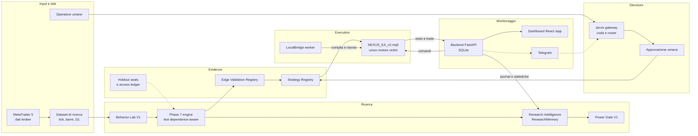
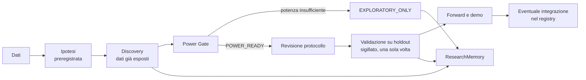

# NEXUS — Ecosistema operativo per trading, ricerca e automazione

NEXUS è un progetto self-hosted che riunisce in un solo repository:

- un **motore di trading** per MetaTrader 5;
- un **laboratorio di ricerca quantitativa** con memoria scientifica e gate statistici;
- un **livello di orchestrazione multi-agente** (Jarvis) con accesso via web e Telegram;
- una **piattaforma** (backend FastAPI, dashboard React, CI, deploy controllato);
- i primi **moduli di business**: agenzia di contenuti AI e first revenue.

Questo README è un'introduzione e un indice. L'unico documento normativo resta
[`docs/NEXUS_MASTER_PROJECT.md`](docs/NEXUS_MASTER_PROJECT.md); lo stato dei
finding è in [`docs/REMEDIATION_STATUS.md`](docs/REMEDIATION_STATUS.md).

> [!WARNING]
> **Stato del progetto: NO-GO per la produzione.**
>
> **Consentito:** sviluppo, simulazione, backtest controllato, conti demo.
>
> **Bloccato:** trading con capitale reale, deploy remoto in produzione, uso
> multi-account sullo stesso backend, modalità istituzionale dell'EA, Virtual SL
> in modalità EXECUTE, azioni live dell'AI Coach.
>
> **Nessun edge di trading è validato.** Nessuna sezione di questo documento va
> letta come promessa di rendimento.
>
> Il backend **rifiuta di avviarsi** con `NEXUS_ENV` diverso da
> DEVELOPMENT/SIMULATION finché restano credenziali di default o segreti
> segnaposto. È voluto.

> **AUD0-DOC-003, precisazione.** Il **core** (EA, backend, dashboard) gira in
> autonomia. Alcune funzionalità **opzionali** dipendono da servizi esterni:
> Telegram per notifiche e Jarvis, Anthropic per l'AI Coach, i provider AI per
> le escalation dell'orchestratore, il provider cloud se non fai self-hosting.

---

## Indice

1. [Visione e missione](#1-visione-e-missione)
2. [Architettura globale](#2-architettura-globale)
3. [Trading Engine](#3-trading-engine)
4. [Ricerca ed Edge Discovery](#4-ricerca-ed-edge-discovery)
5. [Jarvis e sistema multi-agente](#5-jarvis-e-sistema-multi-agente)
6. [Piattaforma e infrastruttura](#6-piattaforma-e-infrastruttura)
7. [Espansione dell'ecosistema](#7-espansione-dellecosistema)
8. [Matrice di stato](#8-matrice-di-stato)
9. [Getting Started](#9-getting-started)
10. [Indice della documentazione e roadmap](#10-indice-della-documentazione-e-roadmap)
11. [Precisazioni dell'audit](#precisazioni-dellaudit-su-questo-documento)

---

## 1. Visione e missione

**Missione.** Costruire un sistema in cui ogni decisione di trading o di
business nasce da evidenze verificabili, passa da gate espliciti e lascia una
traccia auditabile. Gli agenti AI propongono, non decidono da soli.

**Principi operativi** (dal masterplan e dai documenti di architettura):

- l'EA è l'unico motore che invia ordini; nessun agente AI bypassa il Risk Engine;
- un'evidenza ottenuta sui dati di discovery non è una validazione;
- gli holdout sono sigillati e consumabili una sola volta;
- prima gli strumenti deterministici, poi gli agenti locali, solo per ultimi i
  provider premium ([doc 18](docs/architecture/18_ORCHESTRATOR_AGENT_ROUTING_V1.md));
- ogni milestone si chiude con codice, test, commit e documentazione aggiornata.

**Visione futura e capacità attuale**

| Visione (obiettivo) | Capacità attuale (verificabile nel repository) |
|---|---|
| Trading automatico su capitale reale, guidato da edge validati | EA e backend esistono; produzione NO-GO; 0 edge validati |
| Ricerca che impara dai propri esperimenti | ResearchMemory append-only, review a regole, gate di potenza; uso manuale, nessuno scheduler |
| Un assistente unico (Jarvis) che coordina agenti e business | Gateway, coda, router e adapter Telegram nel codice; la messa in produzione è un'operazione separata con approvazione |
| Più linee di business autofinanziate | Agenzia AI in dry-run, bookkeeping first revenue; nessun ricavo dimostrato nel repository |

---

## 2. Architettura globale

Il diagramma mostra il flusso logico e i componenti presenti nel repository.
Le frecce tratteggiate indicano integrazioni opzionali o soggette ad
approvazione.



| Componente | Dove | Ruolo |
|---|---|---|
| Expert Advisor | [`MQL5/Experts/NEXUS_EA_v2.mq5`](MQL5/Experts/NEXUS_EA_v2.mq5) + `MQL5/Include/` | Segnali, rischio, ordini, gestione posizioni |
| LocalBridge | [`LocalBridge/`](LocalBridge/) | Worker sul PC Windows: compila l'EA, riavvia MT5, deploy di file verificati; bridge per agenti locali |
| Backend | [`server/`](server/) | API FastAPI, SQLite, read model, Jarvis, orchestratore, business unit |
| Dashboard | [`frontend/`](frontend/) | Cockpit React servito sotto `/app` |
| Ricerca | [`server/research_scripts/`](server/research_scripts/) | Phase 7, Behavior Lab, Research Intelligence, studi di potenza |
| Contratti | [`contracts/`](contracts/) | Schemi canonici, registry, generatori e validatori |
| Deploy | [`deploy/`](deploy/), [`render.yaml`](render.yaml), [`.github/workflows/`](.github/workflows/) | Manifest per digest, blueprint Render, CI e Safe Deploy |
| Conoscenza | [`docs/`](docs/), [`vault/`](vault/), [`knowledge/`](knowledge/) | Masterplan, architettura, note operative |

---

## 3. Trading Engine

> [!IMPORTANT]
> Il trading reale **non è pronto**. Nessuna modifica MQL5 è stata compilata in
> MetaEditor né eseguita in Strategy Tester negli ambienti di audit (AUD0-TEST-001).

| Elemento | Stato | Riferimento |
|---|---|---|
| `NEXUS_EA_v2.mq5`, release `nexus-3.60` | Codice presente; unico motore d'ordine | [`deploy/deployment-manifest.json`](deploy/deployment-manifest.json) |
| Strategy Registry: 83 strategie (28 ACTIVE, 30 RESEARCH_ONLY, 22 DISABLED, 3 EXPERIMENTAL) | Contratto canonico generato | [`contracts/strategy-registry.json`](contracts/strategy-registry.json), [doc 05](docs/architecture/05_STRATEGY_REGISTRY_SPEC.md), [doc 17](docs/architecture/17_STRATEGY_REGISTRY_RECONCILIATION.md) |
| Risk e protection pipeline | Implementata e verificata staticamente | [doc 07](docs/architecture/07_RISK_AND_PROTECTION_PIPELINE.md) |
| Gestione posizioni, identità trade, ledger eventi | Implementati; serve verifica runtime | [doc 03](docs/architecture/03_TRADE_IDENTITY_MODEL.md), [doc 04](docs/architecture/04_EVENT_LEDGER_SPEC.md), [doc 08](docs/architecture/08_POSITION_MANAGEMENT_OWNERSHIP.md) |
| Comandi backend → EA | Contratto tipizzato | [doc 09](docs/architecture/09_COMMAND_LIFECYCLE.md) |
| LocalBridge | Azioni tipizzate con digest, niente shell arbitraria | [doc 10](docs/architecture/10_LOCALBRIDGE_PROTOCOL.md) |
| Isolamento terminali MT5 e identità conto | Policy e guard documentati | [`MT5_TERMINAL_ISOLATION_POLICY_V1`](docs/MT5_TERMINAL_ISOLATION_POLICY_V1.md), [`MT5_TERMINAL_IDENTITY_GUARD_V1`](docs/MT5_TERMINAL_IDENTITY_GUARD_V1.md) |
| Riconciliazione broker | Aperta: `PLACED` non implica eseguito, chiave primaria per ticket, sync backtest | [`REMEDIATION_STATUS.md`](docs/REMEDIATION_STATUS.md) |
| Max Total Drawdown | Flag di sicurezza aperto | [`RRA_02_MAX_TOTAL_DD_SAFETY_SPEC`](docs/RRA_02_MAX_TOTAL_DD_SAFETY_SPEC.md) |

**Vincoli di autorizzazione.** Capitale reale, modalità istituzionale,
multi-account e Virtual SL EXECUTE restano bloccati. Il passo successivo
raccomandato in `REMEDIATION_STATUS.md` è compilare l'EA e raccogliere
evidenza runtime (compilazione MetaEditor, Strategy Tester, crash e restart,
conto demo).

---

## 4. Ricerca ed Edge Discovery

### Processo



Ogni passo richiede un'approvazione umana; nessun agente promuove una
strategia o modifica parametri live (masterplan §25).

### Componenti

| Componente | Cosa fa | Stato | Riferimento |
|---|---|---|---|
| Strategy Registry | Inventario canonico delle strategie e del loro stato di implementazione | Implementato | [`contracts/strategy-registry.json`](contracts/strategy-registry.json) |
| Edge Validation Registry | Stato dell'edge per strategia, difetti noti, forward | Implementato | [`contracts/edge-validation-registry.json`](contracts/edge-validation-registry.json) |
| Research Intelligence (RI-01) e ResearchMemory | Memoria scientifica append-only, hash-chained, con checkpoint; review a regole; proposte mai applicate automaticamente | Implementato, uso manuale | [`RESEARCH_INTELLIGENCE_V1`](docs/RESEARCH_INTELLIGENCE_V1.md), [`research-memory-v1`](contracts/research-memory-v1.schema.json) |
| Research Loop (RI-02) | Ciclo planner, autorizzazione, controllo overfitting | Implementato, solo su richiesta | [`RESEARCH_LOOP_V1`](docs/RESEARCH_LOOP_V1.md) |
| Research Control Center (RI-03) | Proiezione autenticata in sola lettura della memoria | Implementato | [`RESEARCH_CONTROL_CENTER_V1`](docs/RESEARCH_CONTROL_CENTER_V1.md) |
| Behavior Lab V1 | Analisi di comportamento su tick, barre e sessioni | Implementato | [`behavior_lab_v1/`](server/research_scripts/behavior_lab_v1/) |
| Phase 7 engine | Test dependence-aware, Benjamini-Hochberg, access ledger, sigilli holdout | Implementato | [`phase7/`](server/research_scripts/phase7/) |
| Gestione dell'esposizione | Registro dei dati già visti per ogni dataset e finestra | Implementato | Phase 7.26, letto da RI-01 |
| Edge Detection Capability V1 | Verifica su edge sintetici noti se la pipeline sa distinguerli dal rumore | Concluso: `PIPELINE_UNDERPOWERED` | [`NEXUS_EDGE_DETECTION_CAPABILITY_V1`](docs/NEXUS_EDGE_DETECTION_CAPABILITY_V1.md) |
| Power Gate V1 | Blocca le affermazioni confermative senza potenza statistica certificata | Implementato; con l'evidenza attuale nessun piano è `POWER_READY` | [`NEXUS_POWER_GATE_V1`](docs/NEXUS_POWER_GATE_V1.md) |

**Riproducibilità.** I protocolli sono congelati con hash SHA-256 prima dei
risultati. I manifest registrano input, artefatti e ambiente. I test di
integrità verificano gli hash sui byte canonici Git, indipendenti da CRLF.

**Controllo degli holdout.** L'holdout Phase 7 (`final_holdout_seal_v1`) è
sigillato; l'holdout Phase 6 è già consumato. Nessun gate legge automaticamente
gli split protetti.

### Stato degli edge

Dal [`contracts/edge-validation-registry.json`](contracts/edge-validation-registry.json)
(83 strategie): **0 VALIDATED**, 9 CANDIDATE, 4 BORDERLINE, 3 FAILED,
2 FORWARD_REQUIRED, 65 UNVALIDATED.

- **BREAKOUT_ACC** e **ORDER_BLOCK**: difetto corretto, ma CI95 che include
  lo zero; servono dati forward.
- **LIQ_SWEEP**: OOS n=6, evidenza negativa con campione insufficiente.
- **VOLBRK Serious 3Y**: eseguito, esito FAIL secondo
  [`NEXUS_RRA_01_RESEARCH_RECOVERY_MASTER`](docs/NEXUS_RRA_01_RESEARCH_RECOVERY_MASTER.md).
- **Phase 7.27** ("nessuna strategia batte il benchmark regime-matched") aveva
  potenza ≤ 0,2: il risultato non è informativo.
- Con i dati attuali, un edge di 0,3R richiede circa 180–500 trade
  indipendenti; i candidati D1 ne hanno circa 47.

Dettaglio per strategia: [`TRADING_EDGE_STATUS_RECONCILIATION_V1`](docs/TRADING_EDGE_STATUS_RECONCILIATION_V1.md).

---

## 5. Jarvis e sistema multi-agente

### Implementato nel codice

| Modulo | Funzione | Riferimento |
|---|---|---|
| [`server/jarvis_v1/`](server/jarvis_v1/) | Gateway conversazionale, adapter Telegram, autorizzazione dei task, notifiche, executor multi-stage | [`NEXUS_JARVIS_ACCESS_LAYER_V1`](docs/NEXUS_JARVIS_ACCESS_LAYER_V1.md), [`NEXUS_JARVIS_CONVERSATION_LAYER_V2`](docs/NEXUS_JARVIS_CONVERSATION_LAYER_V2.md) |
| [`server/orchestrator_v1/`](server/orchestrator_v1/) | Task Queue, Router, Ledger, capability registry, policy dei provider | [doc 18](docs/architecture/18_ORCHESTRATOR_AGENT_ROUTING_V1.md), [`NEXUS_PROVIDER_POLICY_REGISTRY_V1`](docs/NEXUS_PROVIDER_POLICY_REGISTRY_V1.md) |
| Dispatcher durevole | Consumer della coda dentro il processo web | [`NEXUS_DURABLE_QUEUE_DISPATCHER_V1`](docs/NEXUS_DURABLE_QUEUE_DISPATCHER_V1.md) |
| Provider connector | Escalation verso Claude o Codex solo per task `ESCALATION_REQUIRED`, con budget premium | [`NEXUS_PROVIDER_CONNECTOR_LAYER_V1`](docs/NEXUS_PROVIDER_CONNECTOR_LAYER_V1.md) |
| Local Agent Bridge | Trasporto outbound verso la workstation per i task assegnati a un tier locale | [`NEXUS_LOCAL_AGENT_BRIDGE_V1`](docs/NEXUS_LOCAL_AGENT_BRIDGE_V1.md) |
| [`server/review_pipeline_v1/`](server/review_pipeline_v1/) | Review multi-agente e gate di finalizzazione | [`vault/02-Business`](vault/02-Business/) (TASK 0008/0009) |
| Executive State | Stato esecutivo condiviso per le risposte di Jarvis | [`NEXUS_EXECUTIVE_STATE_AND_JARVIS_CONVERSATION_V1`](docs/NEXUS_EXECUTIVE_STATE_AND_JARVIS_CONVERSATION_V1.md) |
| AI Coach | Solo proposte; azioni live disabilitate | `server/.env.example` |

**Stato operativo.** Il codice e i test sono nel repository. L'attivazione su
Telegram richiede segreti di produzione, un deploy approvato e la registrazione
del webhook ([runbook](docs/JARVIS_TELEGRAM_PRODUCTION_ACTIVATION.md)). Le note
del vault la indicano come attiva su Render; questa revisione non l'ha
verificata. Il router locale Ministral è disattivato di default
(`ENABLED=false`).

### Ruoli degli agenti (modello operativo)

| Agente | Ruolo |
|---|---|
| Grok | Osservazione e raccolta di segnali esterni |
| Scalper (GPT dedicato) | Validazione quantitativa delle proposte |
| Claude | Implementazione, metodologia scientifica, experiment design |
| Codex | Verifica indipendente, implementazioni multi-file |
| ChatGPT | Pianificazione; second opinion o fallback |
| Agenti locali (Ministral) | Task bounded di tier 1–2, se raggiungibili |

> [!NOTE]
> Il coordinamento tra Grok, Scalper, Claude, Codex e ChatGPT è oggi
> **manuale**: l'operatore passa i risultati da un agente all'altro e approva.
> L'orchestratore automatizza solo il routing dei task verso i tier
> deterministici, locali e Claude/Codex, sempre con approvazione dove richiesta.
> Grok e Scalper non sono integrati nel codice.

---

## 6. Piattaforma e infrastruttura

| Componente | Tecnologia | Stato |
|---|---|---|
| Backend | FastAPI, SQLite, Python 3.10+ | **Configurato**; avvio locale e Docker |
| Dashboard | React, servita sotto `/app`; fallback statico `/login.html` | **Configurato**; build manuale (AUD0-DOC-006) |
| API | EA, worker, dashboard, Jarvis, ricerca | **Configurato** ([`ENDPOINT_MAP.md`](ENDPOINT_MAP.md)) |
| Container | [`server/Dockerfile`](server/Dockerfile), [`docker-compose.yml`](docker-compose.yml) | **Configurato** |
| CI | [`ci.yml`](.github/workflows/ci.yml): backend-tests, security-preflight, docker-smoke, frontend-build | **Attivo** su push e PR |
| Safe Deploy | [`safe-deploy.yml`](.github/workflows/safe-deploy.yml): deploy di uno SHA verificato dalla CI, solo LOW/MEDIUM risk | **Configurato con limitazioni**; HIGH_RISK va in `WAITING_APPROVAL` ([doc](docs/NEXUS_SAFE_AUTO_DEPLOY_V1.md)) |
| Render | [`render.yaml`](render.yaml), auto-deploy nativo disattivato | **Configurato**; stato di produzione non verificato qui |
| Telegram | Notifiche EA e canale Jarvis | **Opzionale**; richiede segreti |
| Anthropic / provider AI | AI Coach, escalation dell'orchestratore | **Opzionale**; soggetto a budget e approvazione |

---

## 7. Espansione dell'ecosistema

Linee di sviluppo oltre il trading. Nessuna ha ricavi dimostrati nel repository.

| Linea | Cosa esiste | Stato | Riferimento |
|---|---|---|---|
| AI Fashion Agency | Business unit con scouting, content engine, roster modelle, policy fail-closed, KPI | **Dry-run**: 0 crediti spesi, 0 contenuti pubblicati, 0 account social creati | [`NEXUS_AI_FASHION_AGENCY_OPERATIONS_V2`](docs/NEXUS_AI_FASHION_AGENCY_OPERATIONS_V2.md), [`README della BU`](server/business_units/ai_fashion_agency/README.md) |
| First Revenue | Bookkeeping Offer → Lead → Payment → Revenue; outreach solo con approvazione umana | **Implementato**; esperimenti manuali | [`NEXUS_FIRST_REVENUE_EXECUTION_V1`](docs/NEXUS_FIRST_REVENUE_EXECUTION_V1.md) |
| Funding Framework | Scoring e gate per ogni opportunità di business | **Adottato** come canone | [`vault/02-Business/Opportunity-Funding`](vault/02-Business/Opportunity-Funding/) |
| Social e contenuti | Linee guida e calendario Instagram; publish disabilitato nel codice | **Pianificato** | [`vault/03-Social`](vault/03-Social/) |
| Servizi e automazioni | Idee di automazione | **Pianificato** | [`vault/04-System`](vault/04-System/) |

---

## 8. Matrice di stato

| Area | Stato | Evidenza |
|---|---|---|
| EA `NEXUS_EA_v2.mq5` e include | PARTIAL: codice presente, nessuna evidenza di compilazione o Strategy Tester | [`REMEDIATION_STATUS.md`](docs/REMEDIATION_STATUS.md) |
| Trading con capitale reale | BLOCKED | [`NEXUS_MASTER_PROJECT.md`](docs/NEXUS_MASTER_PROJECT.md) |
| Modalità istituzionale, multi-account, Virtual SL EXECUTE | BLOCKED | [`REMEDIATION_STATUS.md`](docs/REMEDIATION_STATUS.md) |
| Strategy Registry ed Edge Validation Registry | IMPLEMENTED | [`contracts/`](contracts/) |
| Edge di trading validati | BLOCKED: 0 validati, pipeline sottopotenziata | [`NEXUS_EDGE_DETECTION_CAPABILITY_V1`](docs/NEXUS_EDGE_DETECTION_CAPABILITY_V1.md) |
| ResearchMemory, RI-01/02/03 | IMPLEMENTED, uso manuale | [`RESEARCH_INTELLIGENCE_V1`](docs/RESEARCH_INTELLIGENCE_V1.md) |
| Power Gate V1 | IMPLEMENTED | [`NEXUS_POWER_GATE_V1`](docs/NEXUS_POWER_GATE_V1.md) |
| Backend, API, dashboard | IMPLEMENTED; build frontend manuale | [`ENDPOINT_MAP.md`](ENDPOINT_MAP.md) |
| CI | IMPLEMENTED | [`ci.yml`](.github/workflows/ci.yml) |
| Safe Deploy V1 | PARTIAL: rollback non automatico | [`NEXUS_SAFE_AUTO_DEPLOY_V1`](docs/NEXUS_SAFE_AUTO_DEPLOY_V1.md) |
| Deploy remoto in produzione | BLOCKED | [`REMEDIATION_STATUS.md`](docs/REMEDIATION_STATUS.md) |
| Jarvis e orchestratore | IMPLEMENTED nel codice; attivazione di produzione non verificata qui | [`NEXUS_JARVIS_ACCESS_LAYER_V1`](docs/NEXUS_JARVIS_ACCESS_LAYER_V1.md) |
| Orchestrazione automatica tra Grok, Scalper, ChatGPT | PLANNED: oggi manuale | — |
| Identità condivisa del bridge token | BLOCKED: finding aperto NEXUS-ID-004 | [`NORMATIVE_CONFORMANCE.md`](docs/NORMATIVE_CONFORMANCE.md) |
| AI Fashion Agency | PARTIAL: dry-run | [`NEXUS_AI_FASHION_AGENCY_OPERATIONS_V2`](docs/NEXUS_AI_FASHION_AGENCY_OPERATIONS_V2.md) |
| First Revenue | IMPLEMENTED (bookkeeping) | [`NEXUS_FIRST_REVENUE_EXECUTION_V1`](docs/NEXUS_FIRST_REVENUE_EXECUTION_V1.md) |
| Social, servizi | PLANNED | [`vault/03-Social`](vault/03-Social/) |

---

## 9. Getting Started

### Avvio rapido del backend (Docker)

```bash
cd server
cp .env.example .env        # poi MODIFICA i valori (vedi sotto)
cd ..
docker compose up -d --build
```

Apri il browser su **http://localhost:8001** e fai login con le credenziali
che hai messo nel `.env`.

### Senza Docker (serve Python 3.10+)

```bash
cd server
python -m venv .venv && source .venv/bin/activate   # su Windows: .venv\Scripts\activate
pip install -r requirements.txt
cp .env.example .env        # modifica i valori
set -a; source .env; set +a # carica le variabili (Linux/Mac)
uvicorn app:app --host 0.0.0.0 --port 8001
```

### Configurazione (`server/.env`)

Imposta **almeno** questi valori:

| Variabile | A cosa serve |
|-----------|--------------|
| `NEXUS_BRIDGE_TOKEN` | Token condiviso EA ↔ Backend ↔ Worker. **Deve essere identico** ovunque. |
| `NEXUS_ADMIN_USER` / `NEXUS_ADMIN_PASSWORD` | Credenziali dashboard. La dashboard React (`/app`) usa un campo **email**: imposta `NEXUS_ADMIN_USER` come indirizzo email reale. Password di almeno 12 caratteri. |
| `NEXUS_JWT_SECRET` | Stringa lunga e casuale per firmare le sessioni. Se assente, il backend ne genererebbe una effimera e ogni riavvio invaliderebbe le sessioni: fuori dallo sviluppo l'avvio viene rifiutato. |
| `NEXUS_ENV` | `DEVELOPMENT` \| `SIMULATION` \| `DEMO` \| `PAPER` \| `LIVE`. Da `DEMO` in su i controlli fail-closed sono bloccanti. Un valore sconosciuto è trattato come `LIVE`. |
| `NEXUS_JWT_HOURS` | Durata sessione (default 12h, massimo 24h in ambiente hardened). |
| `NEXUS_ALLOWED_ORIGINS` | Origin ammesse per le mutazioni via cookie (anti-CSRF). |
| `TELEGRAM_BOT_TOKEN` / `TELEGRAM_CHAT_ID` | (Opzionale) per ricevere le notifiche su Telegram. |
| `NEXUS_LICENSE_MODE` | `strict` = valida solo le chiavi in tabella. `open` accetta **qualunque** chiave: è utile solo in sviluppo e viene rifiutato in ambiente hardened. |
| `NEXUS_COACH_ALLOW_ACTIONS` | L'AI Coach non ha autorità di esecuzione: produce proposte. Abilitabile solo in sviluppo. |
| `ANTHROPIC_API_KEY` | (Opzionale) chiave API Claude per l'**AI Coach** (`/api/coach/chat`). Senza, il Coach risponde "non disponibile". |
| `NEXUS_COACH_MODEL` | Modello del Coach (default in `server/.env.example`). |

Non inserire mai valori reali di token, password o chiavi nel repository, nel
vault o nei log. Le variabili di Jarvis e Telegram per la produzione sono
elencate nel [runbook di attivazione](docs/JARVIS_TELEGRAM_PRODUCTION_ACTIVATION.md).

### Collegare l'EA al backend

Nelle proprietà dell'EA in MetaTrader 5:

| Input EA | Valore |
|----------|--------|
| `InpWebURL` | l'indirizzo del backend, es. `http://192.168.1.50:8001` (PC in rete), `http://localhost:8001` (stesso PC) o l'URL HTTPS del tuo VPS |
| `InpWebToken` | **lo stesso** valore di `NEXUS_BRIDGE_TOKEN` nel `.env` |
| `InpEnableWebSync` | `true` |

Poi in MT5: **Strumenti → Opzioni → Expert Advisors → Consenti WebRequest** e
aggiungi l'URL del backend alla whitelist. Riavvia l'EA: comparirà "ONLINE"
nella dashboard entro pochi secondi.

> ⚠️ MT5 permette WebRequest solo verso `http`/`https` espliciti. Se il backend
> è su un altro PC usa l'IP della macchina (non `127.0.0.1`).

### Collegare il LocalBridge worker

Sul PC Windows dove gira MT5:

```powershell
pip install requests
copy LocalBridge\nexus_worker.config.example.json nexus_worker.config.json
# modifica nexus_worker.config.json: backend_url (HTTPS) + bridge_token + path MT5
python LocalBridge\nexus_local_worker.py
```

> ⚠️ **Il worker scrive ed esegue codice sulla macchina di trading.**
> Eseguilo con un account Windows dedicato, con permessi limitati alla cartella
> MQL5. Prima di eseguirlo, verifica il digest dell'artefatto contro
> `GET /api/downloads/local_worker/checksum`. Il worker rifiuta di avviarsi con
> valori di esempio, token corto o `backend_url` non HTTPS. L'azione `shell`
> generica è stata rimossa (era esecuzione di comandi arbitrari).

Dettagli in [`LocalBridge/README_LOCAL_WORKER_IT.md`](LocalBridge/README_LOCAL_WORKER_IT.md).

### Le due dashboard

- **`/app`**: dashboard React "cockpit" (Overview, Live Chart, Strategie,
  Analytics, Journal, AI Coach, Backtest, Risk, MT5 Bridge, Research
  Intelligence, Calendar, Licenze, Settings). È il frontend principale. Login
  con email e password (cookie httpOnly).
- **`/login.html`**: dashboard statica leggera di fallback (stesso backend):
  panoramica EA con Pausa/Riprendi/Chiudi, journal, statistiche per strategia,
  Strategy Chain, override runtime delle impostazioni, stato del Local Bridge.

Per ricostruire la dashboard React:
`cd frontend && npm install --legacy-peer-deps && npm run build`, poi copia
`frontend/build/` in `server/static/app/`.

> **AUD0-DOC-006: questa non è una pipeline di rilascio.** Copiare a mano gli
> artefatti significa che l'immagine può contenere un frontend costruito da un
> commit diverso da quello del backend, senza che nulla lo segnali. La CI
> costruisce il frontend (`frontend-build`) ma non ne pubblica l'artefatto
> versionato: finché è così, **verifica a ogni rilascio** che
> `server/static/app/` provenga dallo stesso commit del backend. È un difetto
> aperto, non una procedura approvata.

### API (contratto con EA e worker)

Tutti gli endpoint EA/worker richiedono l'header `X-Nexus-Token`.

Gli endpoint dashboard usano un **cookie di sessione httpOnly** emesso da
`POST /api/auth/login` (il client React invia `withCredentials`). Le richieste
che modificano stato devono inoltre presentare l'header `X-Nexus-Csrf` con il
valore del cookie `nexus_csrf` (double-submit). Il vecchio `Authorization:
Bearer <jwt>` resta solo per la dashboard statica legacy ed è **rifiutato**
negli ambienti hardened (finding AUD0-DOC-005 / AUD0-SEC-007).

**EA → backend**
`POST /api/ea/push` · `GET /api/ea/command` (richiede `account_id` e `symbol`) ·
`POST /api/ea/command/ack` · `GET /api/ea/settings` ·
`GET /api/ea/locked_profile` · `POST /api/ea/strategy_stats` ·
`POST /api/ea/trade_history_sync` · `POST /api/ea/trade_reason` ·
`POST /api/ea/shadow_trades` · `POST /api/ea/visual_objects` ·
`POST /api/license/verify` · `POST /api/notify/telegram` ·
`GET /api/strategy_chain/config_for_ea`

**Worker ↔ backend**
`POST /api/local_bridge/heartbeat` · `GET /api/local_bridge/poll` · `POST /api/local_bridge/ack`

**Dashboard**
`POST /api/auth/login` · `GET /api/dashboard/overview` · `POST /api/dashboard/command` ·
`GET /api/dashboard/journal` · `GET /api/dashboard/strategy_stats` ·
`GET/PUT /api/dashboard/settings` · `GET/PUT /api/dashboard/locked_profiles` ·
`GET/PUT /api/strategy_chain/config` · `GET /api/local_bridge/status` · `POST /api/local_bridge/enqueue` ·
`GET /api/ea/command_contract` · `GET /api/risk/policy` · `GET /api/audit/operator`

**Salute del servizio**
`GET /api/health`: liveness, prova solo che il processo risponde.
`GET /api/ready`: readiness, cioè database scrivibile, migrazioni applicate,
preflight di sicurezza superato. Restituisce 503 con l'elenco dei problemi.

La mappa completa, incluse le rotte di Jarvis e della ricerca, è in
[`ENDPOINT_MAP.md`](ENDPOINT_MAP.md).

### Deploy su cloud

Il backend è una singola app FastAPI con SQLite: gira su qualsiasi host che
accetta un container. Punta `InpWebURL` (EA) e `backend_url` (worker)
all'URL pubblico HTTPS e aggiungi quell'URL alla whitelist di MT5. Ricorda che
il deploy remoto **in produzione** è bloccato dalla decisione NO-GO.

Guida completa in [`DEPLOY.md`](DEPLOY.md).

**Il build context dell'immagine è la root del repository**, non `server/`:
il backend serve anche il worker LocalBridge e il deployment manifest, che
vivono fuori da `server/`.

```bash
docker build -f server/Dockerfile -t nexus-backend .
```

I dati persistono nel volume Docker `nexus-data` (file `nexus.db`).
**Il volume non è un backup**: protegge dalla sostituzione del container, non
dalla corruzione né dalla cancellazione. Copia periodicamente `/data/nexus.db`
fuori dall'host e verifica il ripristino.

---

## 10. Indice della documentazione e roadmap

### Governance e stato

- [`docs/NEXUS_MASTER_PROJECT.md`](docs/NEXUS_MASTER_PROJECT.md): masterplan e unico documento normativo
- [`docs/REMEDIATION_STATUS.md`](docs/REMEDIATION_STATUS.md): stato dei finding e decisione di rilascio
- [`docs/NORMATIVE_CONFORMANCE.md`](docs/NORMATIVE_CONFORMANCE.md): conformità ai requisiti normativi

### Architettura

- [`docs/architecture/README.md`](docs/architecture/README.md): indice dei documenti 01–18
- [`01_ARCHITECTURE_OVERVIEW`](docs/architecture/01_ARCHITECTURE_OVERVIEW.md) · [`15_DEPLOYMENT_AND_SECURITY`](docs/architecture/15_DEPLOYMENT_AND_SECURITY.md) · [`16_MIGRATION_ROADMAP`](docs/architecture/16_MIGRATION_ROADMAP.md) · [`18_ORCHESTRATOR_AGENT_ROUTING_V1`](docs/architecture/18_ORCHESTRATOR_AGENT_ROUTING_V1.md)

### Ricerca

- [`RESEARCH_INTELLIGENCE_V1`](docs/RESEARCH_INTELLIGENCE_V1.md) · [`RESEARCH_LOOP_V1`](docs/RESEARCH_LOOP_V1.md) · [`RESEARCH_CONTROL_CENTER_V1`](docs/RESEARCH_CONTROL_CENTER_V1.md)
- [`NEXUS_EDGE_DETECTION_CAPABILITY_V1`](docs/NEXUS_EDGE_DETECTION_CAPABILITY_V1.md) · [`NEXUS_POWER_GATE_V1`](docs/NEXUS_POWER_GATE_V1.md) · [`BL01_POWER_AND_BL02_PROPOSAL`](docs/BL01_POWER_AND_BL02_PROPOSAL.md)
- [`TRADING_EDGE_STATUS_RECONCILIATION_V1`](docs/TRADING_EDGE_STATUS_RECONCILIATION_V1.md) · [`NEXUS_RRA_01_RESEARCH_RECOVERY_MASTER`](docs/NEXUS_RRA_01_RESEARCH_RECOVERY_MASTER.md) · [`NEXUS_RRA_02_SCIENTIFIC_STATUS_TAXONOMY_V1`](docs/NEXUS_RRA_02_SCIENTIFIC_STATUS_TAXONOMY_V1.md)

### Jarvis, agenti e deploy

- [`NEXUS_JARVIS_ACCESS_LAYER_V1`](docs/NEXUS_JARVIS_ACCESS_LAYER_V1.md) · [`JARVIS_TELEGRAM_PRODUCTION_ACTIVATION`](docs/JARVIS_TELEGRAM_PRODUCTION_ACTIVATION.md) · [`NEXUS_TELEGRAM_INTERACTIVE_UX_V1`](docs/NEXUS_TELEGRAM_INTERACTIVE_UX_V1.md)
- [`NEXUS_DURABLE_QUEUE_DISPATCHER_V1`](docs/NEXUS_DURABLE_QUEUE_DISPATCHER_V1.md) · [`NEXUS_PROVIDER_CONNECTOR_LAYER_V1`](docs/NEXUS_PROVIDER_CONNECTOR_LAYER_V1.md) · [`NEXUS_LOCAL_AGENT_BRIDGE_V1`](docs/NEXUS_LOCAL_AGENT_BRIDGE_V1.md)
- [`NEXUS_SAFE_AUTO_DEPLOY_V1`](docs/NEXUS_SAFE_AUTO_DEPLOY_V1.md) · [`DEPLOY.md`](DEPLOY.md) · [`ENDPOINT_MAP.md`](ENDPOINT_MAP.md)

### Business

- [`NEXUS_AI_FASHION_AGENCY_OPERATIONS_V2`](docs/NEXUS_AI_FASHION_AGENCY_OPERATIONS_V2.md) · [`NEXUS_FIRST_REVENUE_EXECUTION_V1`](docs/NEXUS_FIRST_REVENUE_EXECUTION_V1.md)

### Roadmap

Ordine dei prossimi passi secondo le fonti canoniche. Non ci sono date
promesse: ogni passo richiede approvazione.

1. **Evidenza runtime dell'EA**: compilazione MetaEditor, Strategy Tester,
   crash e restart, conto demo ([`REMEDIATION_STATUS.md`](docs/REMEDIATION_STATUS.md)).
2. **Chiusura dei finding architetturali aperti**: token condiviso, identità
   admin singola, riconciliazione `PLACED`/eseguito, Max Total DD.
3. **Potenza statistica prima della validazione**: piani di ricerca che
   superino il Power Gate; altrimenti restano `EXPLORATORY_ONLY`.
4. **Forward e demo** per i candidati `FORWARD_REQUIRED`.
5. **Jarvis**: verifica dell'attivazione Telegram secondo il runbook; rollback
   automatico del Safe Deploy (V1.1).
6. **Business**: approvazioni umane per i primi contenuti dell'agenzia;
   esperimenti di first revenue uno alla volta.

---

## Precisazioni dell'audit su questo documento

Punti in cui il README diceva meno di quanto serviva, o lo diceva in modo
ambiguo. Sono qui invece che sparsi nel testo, così restano leggibili insieme.

### Autenticazione: chi usa cosa (AUD0-DOC-002)

| Client | Autenticazione | Protezione CSRF |
|---|---|---|
| Dashboard React (`/app`) | Cookie di sessione `httpOnly` | **Sì**: double-submit con header `X-Nexus-Csrf` e cookie `nexus_csrf`, legati al `jti` del token |
| Script / integrazioni | `Authorization: Bearer <JWT>` | Non applicabile: un client Bearer non invia cookie automaticamente |
| EA MetaTrader e worker LocalBridge | Header `X-Nexus-Token` | Non applicabile |

In DEMO/PAPER/LIVE il Bearer è **rifiutato** sulle rotte di dashboard: in
ambiente indurito l'unico canale umano è il cookie di sessione, che è
revocabile lato server.

### LocalBridge: cosa comporta davvero (AUD0-DOC-004)

- il worker **esegue comandi sul PC** dove gira MT5 (compilazione, deploy di
  file, riavvio del terminale);
- l'esecuzione di shell arbitraria **è stata rimossa**: restano solo azioni
  tipizzate con percorsi e digest verificati;
- il deploy richiede **SHA-256 per ogni file**, mette in staging, attiva in modo
  atomico e fa rollback se qualcosa non torna;
- il riavvio termina **solo** l'eseguibile configurato, non processi arbitrari;
- fuori da Windows il riavvio è un errore permanente, non un tentativo;
- l'host deve essere **arruolato esplicitamente** prima che i suoi heartbeat
  vengano accettati.

Il token del bridge è **condiviso** fra le istanze: chi lo possiede può
impersonare qualunque EA o worker. Vedi
[`docs/NORMATIVE_CONFORMANCE.md`](docs/NORMATIVE_CONFORMANCE.md) (NEXUS-ID-004).

### Il sito statico e `/app` sono pubblici, di proposito (AUD0-API-006)

Le rotte statiche e l'applicazione React non richiedono autenticazione: sono
l'involucro, non i dati. Ogni chiamata API che espone dati operativi passa da
`require_user` o `require_mutation`. Il bundle React **non deve contenere
segreti**: non li contiene, e la CI ha uno scanner che lo verifica a ogni push.

### I grafici a candele sono sintetici (AUD0-DATA-003)

L'endpoint dei grafici genera candele matematiche e dichiara la provenienza
`SYNTHETIC_DATA`. Non sono dati di mercato reali. La dashboard deve mostrare
quella provenienza in modo visibile e **non** mescolare candele sintetiche con
marcatori di trade reali senza avvertimento.

### Evidenza di esecuzione MT5: assente (AUD0-TEST-001)

Nessuna delle modifiche a `MQL5/` è stata compilata in MetaEditor né eseguita in
Strategy Tester negli ambienti di audit. La verifica fatta è statica
(bilanciamento dei blocchi, unicità delle definizioni, ordine di dichiarazione
fra moduli, coerenza con il registro canonico). **Prima di usare capitale
reale**, l'EA va compilato e fatto girare in Strategy Tester e su conto demo.

### Identificatori dei finding, non numeri di PR (AUD0-GOV-001)

Le etichette `PR6`/`PR7`/`PR8` nella storia del repository non corrispondono
sempre al numero della pull request su GitHub. Per riferirsi a un lavoro, usa
gli **identificatori dei finding** (`AUD0-*`, `NXS-*`, `NEXUS-*`): sono
immutabili e tracciabili in `docs/REMEDIATION_STATUS.md`.

### Inventario dei file (AUD0-INV-001)

L'inventario originale della migrazione non copre più il repository. La
tabella dei componenti nella [sezione 2](#2-architettura-globale) è
l'inventario corrente ad alto livello; `deploy/deployment-manifest.json` è
quello **verificabile per digest** degli artefatti distribuiti.

---

*Migrato da Emergent: il progetto è self-hosted e indipendente.*
